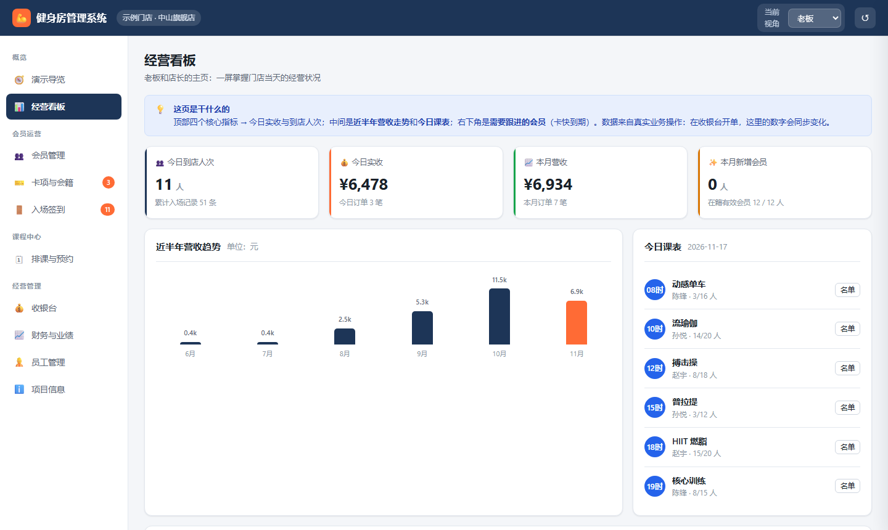
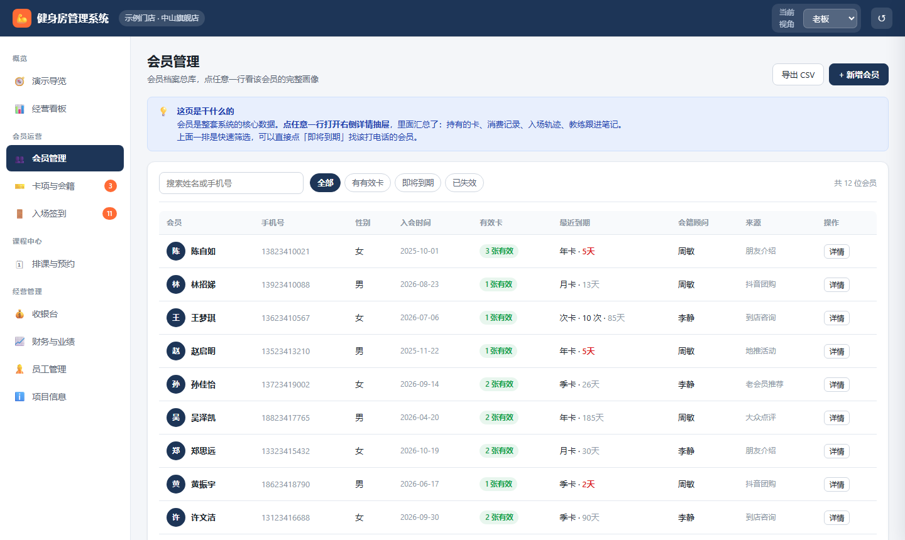
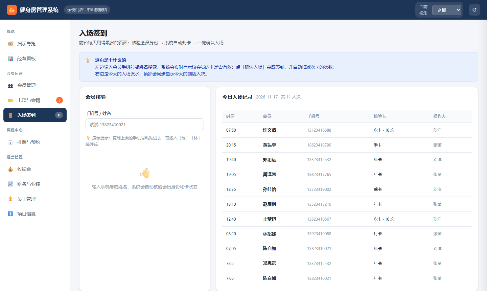
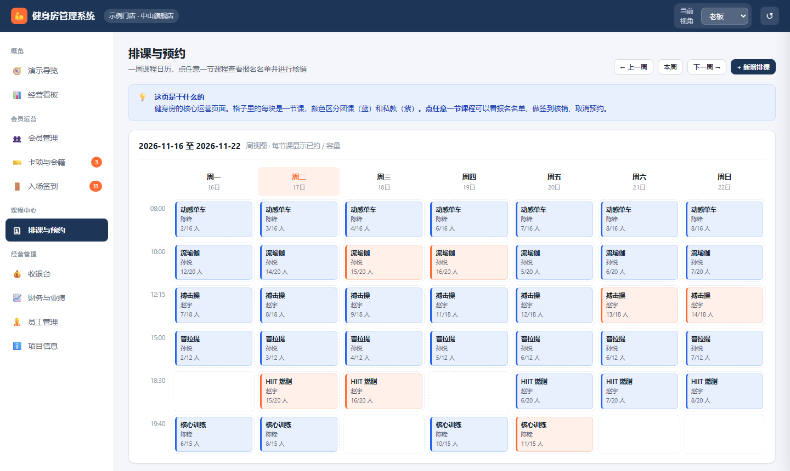

# 健身房管理系统

一套面向**单店健身房**的轻量化管理系统，覆盖会员、卡项、课程、收银、员工五条业务线。
纯前端实现，**零依赖、零后端、双击即可离线运行**，适合作为业务原型、课程设计或二次开发的教学底座。

> 版本：V1.0（MVP 原型版）　|　许可：MIT

---

## 为什么做这个

中小型健身房最核心的资产是**会员续费率**，而依赖 Excel 与微信群的人工管理方式正在持续损耗这笔资产：

| 痛点 | 表现 |
| --- | --- |
| 会员档案混乱 | 手工记账易错漏，历史消费与跟进无法追溯 |
| 到期无人提醒 | 会员卡到期没有预警，会员默默流失 |
| 约课全靠接龙 | 满员、候补、临时取消全靠口头协调 |
| 业绩算不清 | 提成月底手工核算，口径不一争议频发 |

本系统以最低的使用门槛，把上述四条链路一次性规范化。

## 功能特性

### 五类角色，菜单级权限隔离（RBAC）

| 角色 | 可见范围 |
| --- | --- |
| 老板 | 经营看板、财务与业绩 |
| 店长 | 会员、卡项、课程、员工、财务 |
| 前台 | 收银开单、入场签到、课程预约名单 |
| 教练 | 本人课表与学员名单（数据范围收敛至本人） |
| 会员 | 会员自助端（查卡、约课、打卡） |

### 八条业务主线

- **会员管理** — 档案增删改查、多条件筛选、会员画像抽屉、跟进笔记、CSV 导出
- **卡项与会籍** — 时间卡 / 次卡 / 私教包三类卡统一建模、办卡续卡、停卡复卡、到期预警
- **入场签到** — 手机号检索、卡有效性核验、次卡自动扣减、当日流水
- **排课与预约** — 周日历排课、约课率可视化、报名名单、核销与取消
- **收银开单** — 选会员选卡、支付方式、业绩归属、提成自动计算
- **财务与业绩** — 订单流水、客单价统计、员工业绩榜、教练课时结算
- **员工管理** — 员工档案、角色配置、提成比例与课时费维护
- **会员自助端** — 卡余额查询、在线约课、到店打卡、消费记录

### 数据联动

所有页面读取同一份数据源，**一次写入、全局更新**：开单一次收款，会员持卡、经营看板营收、订单流水、员工业绩四处数据同步变化，从根源上避免"报表打架"。

## 界面预览

| 经营驾驶舱 | 会员管理 |
| --- | --- |
|  |  |

| 入场签到 | 排课与预约 |
| --- | --- |
|  |  |

## 快速开始

### 方式一：双击运行（推荐）

直接双击 `index.html`，或 Windows 下双击 `一键启动.bat`。无需安装任何环境。

### 方式二：本地静态服务

```bash
# 任选其一
python -m http.server 8080
npx serve .
```

然后访问 `http://localhost:8080`。

> 数据保存在浏览器 `localStorage`，清除浏览器数据或点击顶栏「恢复演示数据」即可重置。

## 目录结构

```
.
├── index.html                  # 单页应用入口
├── 一键启动.bat                # Windows 一键运行
├── assets/
│   ├── styles.css              # 全局样式与组件样式
│   ├── data.js                 # 实体定义、种子数据、存储层
│   ├── app.js                  # 状态管理、路由、权限、公共组件
│   ├── pages.js / pages2.js    # 各业务页面渲染
│   ├── actions.js              # 业务动作与数据写回
│   └── member.js               # 会员自助端
└── docs/screenshots/           # 界面截图
```

## 技术栈

| 维度 | 方案 |
| --- | --- |
| 前端 | HTML5 + CSS3 + 原生 JavaScript（无框架、无构建、无 CDN） |
| 架构 | 单页应用 SPA · 状态驱动渲染 · 哈希路由 |
| 分层 | 数据层 / 页面渲染层 / 交互动作层 三层分离 |
| 权限 | RBAC：角色 → 菜单 → 数据范围 |
| 存储 | localStorage，不可用时自动降级为内存存储 |
| 运行环境 | Chrome / Edge / Firefox 任意现代版本 |

## 数据模型

九张数据表，均以会员表为核心实体向外收敛：

| 表 | 业务用途 |
| --- | --- |
| `members` | 会员档案 |
| `card_templates` | 卡项模板（6 种卡） |
| `member_cards` | 会员持卡（时间卡 / 次卡 / 私教包统一建模） |
| `courses` | 课程库 |
| `schedules` | 课程排期 |
| `bookings` | 预约与核销（已约 / 签到 / 取消 / 爽约 状态机） |
| `orders` | 订单流水 |
| `checkins` | 入场流水 |
| `staff` | 员工档案与提成参数 |

设计要点：

- **统一卡模型** — 一张 `member_cards` 表按 `type` 字段区分三类卡，新增卡种只需加一条模板配置，不改代码、不改表结构。
- **状态机建模** — 预约与卡状态显式流转，业务动作即状态迁移，天然可追溯。
- **可迁移** — 字段命名与 MySQL 表结构一一对应，替换存储层即可上后端。

## 路线图

- [x] **一期 · 原型验证**：业务逻辑跑通，离线可演示
- [ ] **二期 · 前后端分离**：Vue3 + SpringBoot + MySQL / Redis，接入真实登录鉴权与微信小程序
- [ ] **三期 · 云原生与多租户**：微服务拆分、容器化部署、连锁门店分级看板、IoT 硬件接口

## 已知限制

- 数据存于浏览器本地，不支持多设备同步
- 权限为前端菜单级控制，未接入服务端鉴权
- 报表以基础统计为主，暂无数据挖掘与预测
- 热门课程预约未做并发控制，理论上存在超卖可能

## 许可

[MIT](LICENSE) © 2026 FOCUSSS8
